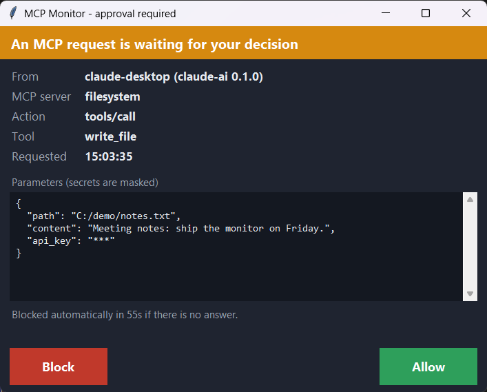

# MCP Communication Monitor

A Python app that watches the tool calls Claude makes to MCP servers and **asks you Allow or Block for each one**, in a popup that appears on top of your other windows. A blocked call is never executed, and Claude gets a clear refusal back.

Works with **Claude Desktop**, **Claude Code** and **Claude Web (claude.ai)**.



**Demo video:** [Watch on Google Drive](https://drive.google.com/file/d/1KmlYrS3Nwg7mV554VrMm7YOxtjWH9twB/view?usp=sharing)

## What it does

* **Holds every tool call** until you decide. Allow forwards the original request; Block answers Claude directly, and the real tool never sees it.
* **Shows what is being asked:** who is asking, which MCP server, which tool, and the parameters (secrets masked).
* **Handles many requests at once:** one popup per request, decided independently.
* **Fails safe:** if anything goes wrong (monitor not running, no answer, crash), the request is blocked.
* **Keeps an audit log** of every request and decision.

## Quick start

Requires Python 3.10+ (developed on Windows 11).

```bash
git clone https://github.com/Ashish558/MCP-Communication-Monitor.git
cd MCP-Communication-Monitor
python -m venv .venv
.venv\Scripts\python -m pip install -e ".[tray,gateway]"

.venv\Scripts\python scripts\popup_demo.py     # try it: three simultaneous popups, no Claude needed
.venv\Scripts\python -m pytest -q              # run the 100 tests
```

To use it with Claude, follow **[docs/setup.md](docs/setup.md)**.

## What is intercepted

| What Claude uses | Intercepted? | How |
|---|---|---|
| Local MCP server in Claude Desktop | Yes, a real block | A shim wraps the server in Claude's config |
| Local MCP server in Claude Code | Yes, a real block | Same shim |
| Your own remote MCP server, used from Claude Web | Yes, a real block | Gateway and a tunnel; the tunnel address is the connector |
| Connector added directly in claude.ai (Figma, Gmail, Slack...) | Yes, **best effort**, in the browser only | A [browser extension](extension/README.md) holds claude.ai's own "Allow once" click until you answer in our popup (verified with Figma in Edge) |
| The same connectors used in Claude Code | Yes, a real block | A Claude Code `PreToolUse` hook asks our popup before the call runs. Verified with Figma in a terminal Claude Code session and in Claude Desktop's Code tab; not tried in IDE extensions |
| The same connectors in the Claude Desktop chat tab | **No** | Not attempted: the chat tab has no hook, and our shim and gateway are not in the path |

Claude Web calls tools from Anthropic's cloud, not from your PC, so a program on your PC can only stand in the path where the tool's address is its own (the gateway), or act on the approval click that happens in your browser (the extension). Details and the full list of limits: [docs/edge-cases.md](docs/edge-cases.md).

## How it works, in short

```
Claude Desktop / Code --> shim --> real MCP server
Claude Web --> tunnel --> gateway --> real MCP server
Browser extension --> bridge
Claude Code hook (claude.ai connectors)
        shim / gateway / bridge / hook --> daemon (queue, popup, audit log) --> you: Allow or Block
```

Full explanation with diagrams: [docs/architecture.md](docs/architecture.md).

## Documentation

| Document | Contents |
|---|---|
| [docs/setup.md](docs/setup.md) | Install and setup for each kind of tool, undo and recovery, troubleshooting |
| [docs/configuration.md](docs/configuration.md) | Settings, environment variables, command reference, log files |
| [docs/architecture.md](docs/architecture.md) | How interception works, components, concurrency, failure handling, design decisions |
| [docs/security.md](docs/security.md) | Security controls, trust boundaries and limits |
| [docs/edge-cases.md](docs/edge-cases.md) | Every edge case, what happens, and the test or check that proves it |
| [docs/testing.md](docs/testing.md) | How to run the tests, what they cover, what was verified by hand |
| [docs/test-results.md](docs/test-results.md) | Captured results of the 100 tests, and real-use counts from the audit log |
| [extension/README.md](extension/README.md) | The claude.ai browser extension |

## Project layout

```
src/mcp_monitor/
  protocol.py    JSON-RPC helpers, secret masking, safe display text
  gatekeeper.py  one "ask the daemon, apply the failure rule" routine
  shim.py        stdio proxy in front of one MCP server
  gateway/       HTTP gateway for Claude Web
  bridge.py      local endpoint the browser extension asks for decisions
  hook.py        Claude Code PreToolUse hook for claude.ai connectors in Claude Code
  ipc.py         proxy <-> daemon channel (127.0.0.1 + token)
  daemon/        decision engine (queue, timeouts, cancel), Tk popups, tray, audit log
  installer.py   backup-first config wrapping and unwrapping
  cli.py         python -m mcp_monitor <command>
extension/       claude.ai browser extension (JavaScript)
tests/           100 tests and a fake MCP server
scripts/         popup demo, screenshot helper
docs/            documentation
```

## Known limits

* Claude.ai connectors (Figma, Gmail...) in the Claude Desktop chat tab work normally but are not monitored: no shim, gateway or hook is in their path, and interception there was not attempted. In Claude Code they are covered by the hook.
* The browser extension works only when claude.ai shows its own approval prompt; it is best effort.
* Developed and tested on Windows; popups open on the primary monitor; the daemon does not start at login.
* In the Claude Desktop version tested (5.11492) every session ran in the app's agent mode; the separate chat engine connected to the shim but made no tool call, so only agent-mode calls were observed.
* The browser extension is JavaScript, because browser extensions cannot be written in Python. Everything else is Python.

## License

[MIT](LICENSE)
