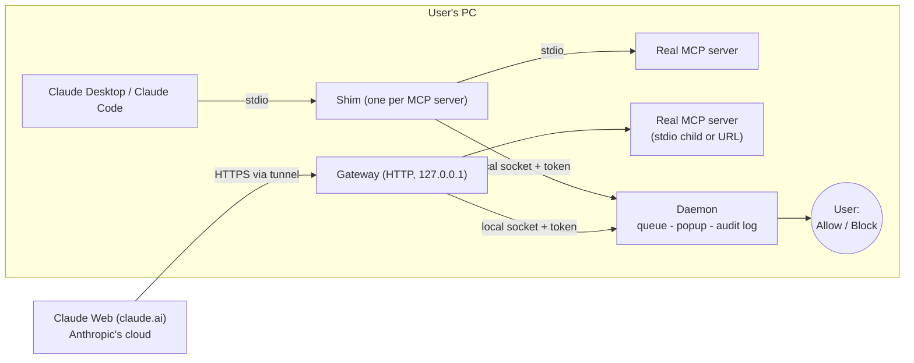
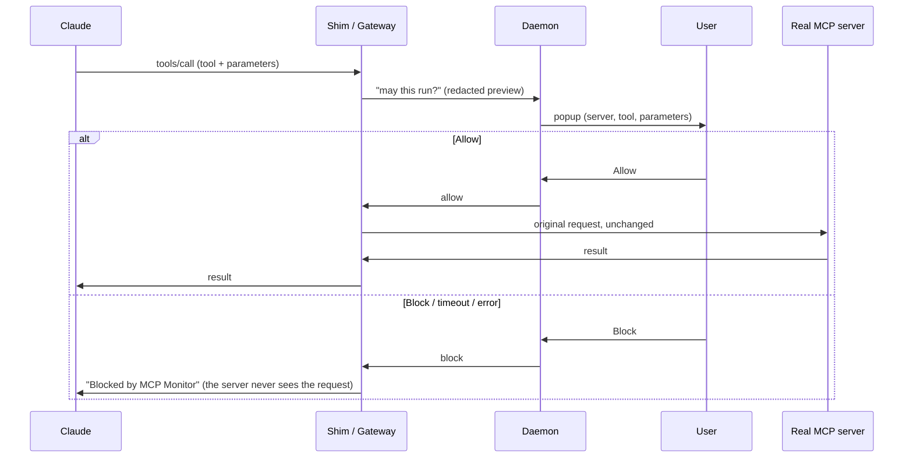

# Architecture and approach

This document explains how MCP Monitor intercepts MCP traffic, why it was built this way, and how it behaves when things go wrong.

## In 60 seconds

* **Problem.** When Claude uses a tool it sends a request to an MCP server, and nothing asks the user first.
* **Idea.** Put a small program in the path of every request. It **holds** each tool call, asks a background app (the daemon), which shows a popup. **Allow** forwards the original request; **Block** answers Claude itself and the real server never sees it.
* **Four doors, one decision engine.**
  * *Shim*: local servers in Claude Desktop and Claude Code (the config makes Claude start the shim instead of the server).
  * *Gateway*: servers that Claude Web reaches over HTTPS (the tunnel address is the gateway's).
  * *Browser extension + bridge*: connectors added directly in claude.ai, best effort (it holds claude.ai's own "Allow once" click).
  * *Claude Code hook*: claude.ai connectors used inside Claude Code (Claude Code asks our hook before every tool call).
* **Safe by default.** If the monitor is unsure (daemon down, no answer, error) the request is blocked.
* **More detail.** [Setup](setup.md), [configuration](configuration.md), [security](security.md), [edge cases](edge-cases.md), [testing](testing.md).

## 1. The problem

When Claude uses a tool (read a file, search, send a message) it sends a small JSON request to an **MCP server**. By default nothing asks the user before the request runs. The goal is to hold **each individual request**, show it to the user, and run it only after the user clicks **Allow**. If the user clicks **Block**, the request must not run and Claude must get a clear refusal.

The difficulty: Claude Desktop, Claude Code and Claude Web do not reach MCP servers in the same way.

| Client | How the MCP call travels | Where we can stand in the middle |
|---|---|---|
| Claude Desktop / Claude Code, local server | Client starts the server as a child process and talks to it over **stdin/stdout** | On the user's PC, between the client and the child process |
| Claude Web (claude.ai), connector | **Anthropic's servers** call the MCP server's URL over HTTPS | Only at the URL itself, which therefore has to be ours |

## 2. Approach: a proxy in the path

The only reliable way to *pause and block* a request is to be the program the request passes through. So there are two small proxies that share one decision engine:

* **Shim**: Claude is told (in its config file) to start the shim instead of the real server. The shim starts the real server itself and relays every message in both directions.
* **Gateway**: a small web server that speaks MCP over HTTP. A tunnel (Cloudflare Quick Tunnel or ngrok) gives it a public HTTPS address, which the user adds as a custom connector in claude.ai.
* **Daemon**: one background app that owns the popup, the queue of waiting requests, and the audit log. Shims and the gateway ask it for every decision.

### A third door for connectors added directly in claude.ai (best effort)

A connector added in claude.ai is called by Anthropic's cloud, so neither the shim nor the gateway sees it. One hook remains: claude.ai shows "Claude wants to use X from Y: Decline / Always allow / Allow once" in the browser, and the tool runs only after the browser sends that approval. A small **browser extension** holds the approving click, sends the tool name, connector and displayed parameters to a local **bridge** (`bridge.py`, which uses the same gatekeeper and popup), and then clicks "Allow once" or "Decline" for the user. "Always allow" is converted into "Allow once" so every call stays gated.

This is deliberately labelled best effort: it only works when claude.ai shows its prompt, it reads the parameters as displayed (not the raw request), it depends on the prompt's layout, and it covers the browser only. It fails closed (any error means Decline). Details: [extension/README.md](../extension/README.md).

### A fourth door for Claude Code: a `PreToolUse` hook

Claude Code can run a command before every tool call, MCP tools and claude.ai connectors included (tool names look like `mcp__<server>__<tool>`). `hook.py` is registered as that command. It reads the call from stdin, asks the daemon through the same gatekeeper (so the popup, queue and audit log are shared), and answers Claude Code: **exit 0 with `permissionDecision: "allow"`** to allow, **exit 2 with a reason** to block. Exit 2 is Claude Code's documented way to block a call, and every failure path in the hook uses it. A hook that fails with any other exit code would let the call through, so the installer also sets `"onFailure": "block"`. Unlike the shim and gateway, the hook does not sit in the data path: it is a gate Claude Code itself consults, which is why it can cover connectors that Anthropic's servers run.

### Alternatives that were rejected

| Idea | Why not |
|---|---|
| Sniff network traffic | MCP over HTTPS is encrypted, and sniffing can watch but never block. |
| Inject code into the Claude app (Electron debugging, DLL hooks) | Breaks on every update and may violate the app's terms. |
| A passive browser extension that only watches claude.ai | It could see the call but not stop it. (The extension we ship holds claude.ai's own approval click, which does let it block.) |
| Watch for new processes | Shows that a server started, not what it was asked to do. |

## 3. What happens to one request

Details that matter:

* Only requests in `intercept_methods` (default: `tools/call`) are held. Everything else (`initialize`, `tools/list`, notifications, responses) passes through untouched, so the proxy works with any MCP protocol version and never rewrites a message.
* Allowed requests are forwarded as the **original bytes**, not a re-encoded copy.
* A block is a normal tool result with `isError: true` and a readable message, so the model can explain the refusal to the user. Non-tool methods get a JSON-RPC error instead.
* The popup shows the client, MCP server, tool and parameters. The server name comes from the config key (shim) or the gateway's `--name`; tool and parameters come from the request itself; the client name comes from the MCP `initialize` handshake.

## 4. Components

| Module | Responsibility |
|---|---|
| `protocol.py` | Pure functions: classify messages, build denials, mask secrets, make text safe to display. |
| `hook.py` | Claude Code `PreToolUse` hook: gates MCP tools (including claude.ai connectors) in Claude Code. |
| `gatekeeper.py` | The single "ask the daemon, apply the failure rule" routine used by both proxies. |
| `shim.py` | Stdio proxy: holds/forwards/denies, tracks in-flight requests, handles server crashes, cleans up the child. |
| `gateway/` | HTTP proxy for Claude Web: session handling, upstream (stdio or HTTP), security checks. |
| `ipc.py` | Local channel between proxies and daemon (127.0.0.1, random port, secret token). |
| `daemon/broker.py` | Decision engine: pending queue, timeouts, cancellation, cleanup. UI-independent. |
| `daemon/ui.py` | Tkinter popups; `daemon/tray.py` optional tray icon; `daemon/audit.py` JSON-lines log. |
| `installer.py` | Safely edits Claude config files: backup first, dry-run, atomic write, exact undo. |
| `jobobject.py` | Windows job object so a killed shim cannot leave an orphaned MCP server. |

The broker only talks to a small `Presenter` interface (`show`, `close`, `pending_changed`). The tests use a rule-driven presenter instead of the popup, which is how the full request path is tested without a human.

## 5. Concurrency

* Every request gets a unique id and its own popup card. Decisions are independent and the first answer wins.
* The daemon runs an asyncio loop on a background thread; the Tk window runs on the main thread. They communicate through a thread-safe queue and `Broker.resolve`, which is safe to call from any thread.
* At most 3 popups are on screen (configurable); the rest wait in a queue and open as earlier ones are answered. More than `max_pending` (100) at once are blocked immediately.
* Held requests never block other traffic: `tools/list`, pings and other calls keep flowing while a popup is open.
* JSON-RPC ids are matched exactly (`1` and `"1"` are different), and two shims using the same id never collide because the daemon assigns its own ids.

## 6. Failure handling (fail closed)

The rule: **if the monitor cannot be sure the user said yes, the request is blocked.** (`fail_mode: "open"` exists but is never the default.)

| Situation | Result |
|---|---|
| Daemon not running | Shim tries to start it; if that fails, the request is blocked with an explanation. Other traffic still works. |
| Daemon crashes or is stopped while a popup is open | Every waiting request is blocked. |
| User ignores the popup | Blocked after `decision_timeout` (60 s default). |
| User closes the popup window or presses Esc | Block. Buttons ignore clicks for 0.6 s and Enter does nothing, so a stray keypress cannot approve. |
| Claude cancels or hangs up while waiting | Popup is dismissed and the request is withdrawn; nothing runs. |
| Real server crashes | Every in-flight request gets an error reply; the shim exits with the server's exit code. |
| Claude closes the shim | Real server is shut down (and killed if needed); a Windows job object covers hard kills. |
| Unexpected error inside the monitor | Caught, logged, and treated as Block. |
| Malformed data | A line that is not valid JSON cannot be recognised as a tool call, so it is passed on (the real server rejects it) and logged. It never crashes the proxy. |
| Emergency | `MCP_MONITOR_DISABLE=1` turns shims into plain pass-through. |

## 7. Security

The full security model (controls, trust boundaries, limits) is in [security.md](security.md). The short version: everything local is token-protected and bound to 127.0.0.1, the popup shows masked plain text with look-alike characters escaped, buttons ignore input for 0.6 s after appearing, and config changes are backed up and reversible.

## 8. Design decisions and trade-offs

* **Proxy over hooking.** More setup (a config change) but it is stable, readable, and can really block.
* **One decision engine, two doors.** Adding the gateway needed no change to the popup or the queue.
* **Tkinter.** No extra dependency and good enough for a topmost dialog; the UI sits behind the `Presenter` interface so it can be swapped.
* **Standard library for the core.** The shim has no third-party dependencies (it starts on every server launch). Only the gateway needs `aiohttp`; the tray icon needs `pystray` + `Pillow` and is optional.
* **Block replies are results, not protocol errors**, so the model sees why and can tell the user.

## 9. Known limitations

* Claude.ai connectors in the Claude Desktop chat tab are not monitored (no shim, gateway or hook is in their path; interception there was not attempted).
* Connectors added in claude.ai are covered only by the best-effort browser extension.
* The gateway refuses JSON-RPC batches and does not support server-initiated streams.

The complete list, with reasons, is in [edge-cases.md](edge-cases.md#9-known-gaps-and-limits-honest-list).

## 10. Testing

100 automated tests plus manual checks on the real Claude apps. See [testing.md](testing.md).
